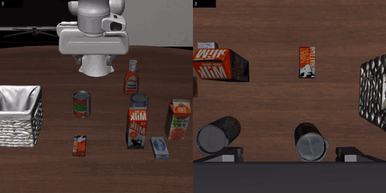
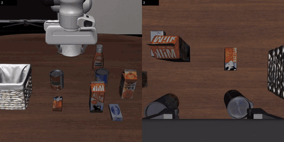
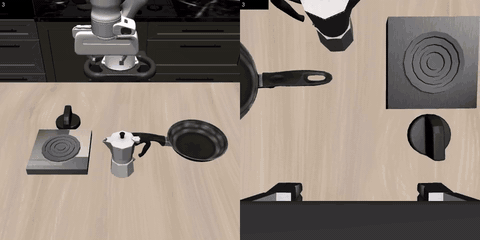
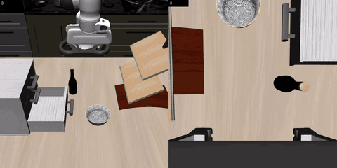
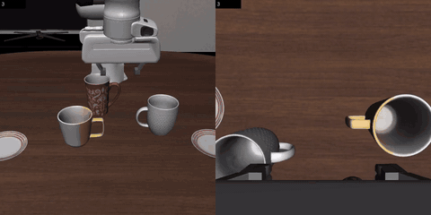
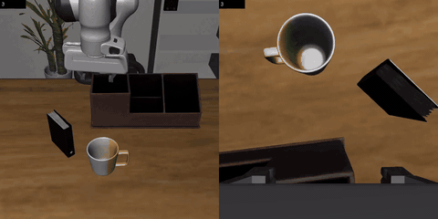
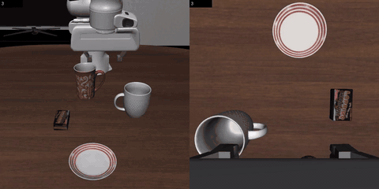
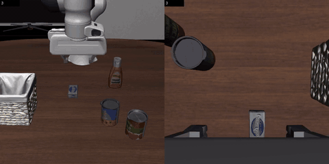
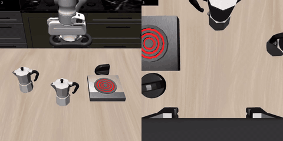
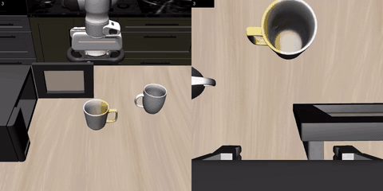

# LIBERO-10 with a Gemini agent

One episode on each of the 10 LIBERO-10 tasks, controlled by `gemini-4-argon` through `agent.py`: every call it sees the
last 2 s of video and the current image of each camera, and answers with the next 10 actions of the 7-D LIBERO command
(see the [main README](../README.md)). Seed 0, the 520-step limit of LIBERO-10, 480 px cameras, no privileged
simulator information.

**1 of 10 tasks succeeded.** Success is the simulator's own check, not the model's claim. An episode is 52 calls at most; the
ten episodes used about 6.1M input tokens, 181k output tokens and 54k thinking tokens. These are single
episodes: they say what happened in each run, not how often the agent succeeds.

| task | instruction | result | steps | calls |
|---|---|---|---|---|
| [0](#task-0) | put both the alphabet soup and the tomato sauce in the basket | no success | 520 | 52 |
| [1](#task-1) | put both the cream cheese box and the butter in the basket | **success** | 478 | 48 |
| [2](#task-2) | turn on the stove and put the moka pot on it | no success | 520 | 52 |
| [3](#task-3) | put the black bowl in the bottom drawer of the cabinet and close it | no success | 520 | 52 |
| [4](#task-4) | put the white mug on the left plate and put the yellow and white mug on the right plate | no success | 520 | 52 |
| [5](#task-5) | pick up the book and place it in the back compartment of the caddy | no success | 520 | 52 |
| [6](#task-6) | put the white mug on the plate and put the chocolate pudding to the right of the plate | no success | 520 | 52 |
| [7](#task-7) | put both the alphabet soup and the cream cheese box in the basket | no success | 520 | 52 |
| [8](#task-8) | put both moka pots on the stove | no success | 520 | 52 |
| [9](#task-9) | put the yellow and white mug in the microwave and close it | no success | 520 | 52 |

## Episodes

Time-lapses at 2x speed (one frame every 8 simulator steps, 0.4 s), both cameras side by side: the agentview on the left,
the wrist camera on the right. Made from the saved `episode.mp4` of each run (kept locally in `outputs/agent/libero10/`,
which is not tracked) with `ffmpeg` (`fps=2.5`, 480x240, 96 colours).

### Task 0

put both the alphabet soup and the tomato sauce in the basket: no success in 520 steps (52 calls).

  

### Task 1

put both the cream cheese box and the butter in the basket: success at step 478 (48 calls).

  

### Task 2

turn on the stove and put the moka pot on it: no success in 520 steps (52 calls).

  

### Task 3

put the black bowl in the bottom drawer of the cabinet and close it: no success in 520 steps (52 calls).

  

### Task 4

put the white mug on the left plate and put the yellow and white mug on the right plate: no success in 520 steps (52 calls).

  

### Task 5

pick up the book and place it in the back compartment of the caddy: no success in 520 steps (52 calls).

  

### Task 6

put the white mug on the plate and put the chocolate pudding to the right of the plate: no success in 520 steps (52 calls).

  

### Task 7

put both the alphabet soup and the cream cheese box in the basket: no success in 520 steps (52 calls).

  

### Task 8

put both moka pots on the stove: no success in 520 steps (52 calls).

  

### Task 9

put the yellow and white mug in the microwave and close it: no success in 520 steps (52 calls).

  

